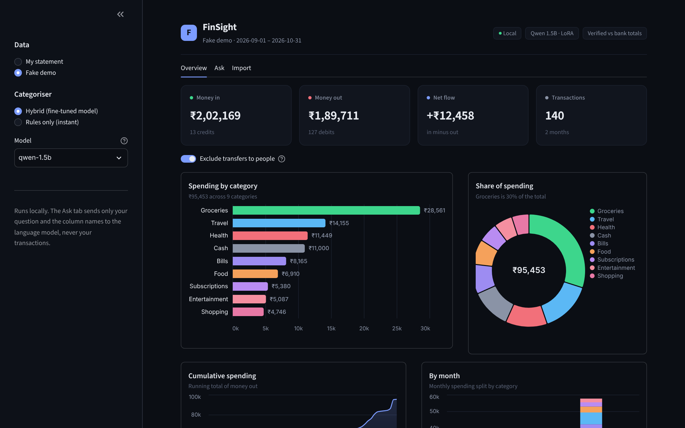
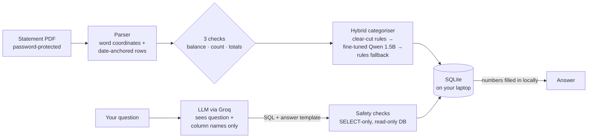
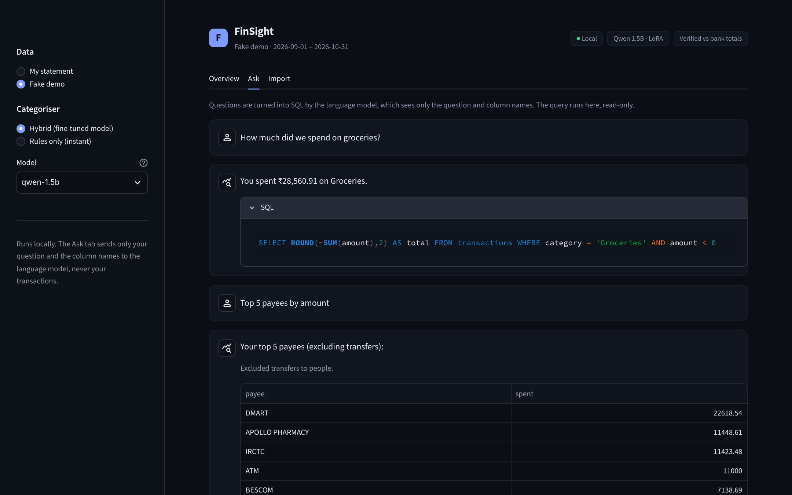

# 💸 FinSight: a private AI agent for Indian bank statements

Ask your bank statement questions in plain English ("How much did we spend on Swiggy?"), with the **statement parsed, categorised and queried on your own laptop**. A big LLM only ever sees your question and the table's column names, never your transactions.



**What's inside**

- **A verified PDF parser** for password-protected HDFC statements: 192/192 real transactions, with counts and debit/credit totals matching the bank's own summary to the paisa.
- **A fine-tuned 1.5B LLM (LoRA)** that categorises UPI/bank narrations: **82.3% on merchants it never saw**, comparable to a **120B** zero-shot model (84.7%) at **80× smaller**, running locally.
- **A text-to-SQL agent** with two safety layers (SELECT-only checks + a read-only database) and self-correction on SQL errors: **95% execution accuracy** (19/20) on a gold-SQL benchmark.
- **A Streamlit app** with a dashboard and chat, running at `localhost`.

> All screenshots and committed data are **synthetic**. No real bank data is in this repository.

---

## Results

### Transaction categorisation (15 categories)

Tested on 300 held-out narrations of known merchants (**seen**) and 300 of merchants, shop names and people **never in training** (**unseen**).

| Method | Seen | Unseen | Notes |
|---|---|---|---|
| Rules (lookup + keywords) | 90.7% | 38.3% | Only knows what's in its list |
| gpt-oss-120b, zero-shot (Groq API) | 86.7% | **84.7%** | Strong, but online, costly at scale, sees your data |
| Qwen2.5-0.5B, zero-shot | 3.3% | 2.3% | Before training |
| Qwen2.5-0.5B + LoRA | 96.7% | 73.0% | 2.1 min training on a free Colab T4 |
| Qwen2.5-1.5B, zero-shot | 26.7% | 26.7% | Before training |
| **Qwen2.5-1.5B + LoRA** | **97.7%** | **82.3%** | Runs on a laptop CPU, data never leaves it |

With 300 test examples each score carries roughly ±2 points of uncertainty, so 82.3% vs 84.7% is best read as *comparable*.

### Real-data check

On the first 15 transactions of a real statement, hand-labelled: **hybrid 86.7%** (13/15), model alone 80%, rules 93.3%. The rules score is inflated by **data leakage**: their formats were written while looking at that statement. Every model error traced back to a format missing from the synthetic training data (**distribution shift**), e.g. squashed merchant names like `PAYUZOMATOLIMITED`.

### Agent (text-to-SQL)

**Execution accuracy: 19/20 (95%)** on 20 questions with hand-written gold SQL (`eval_agent.py`), on the synthetic statement with its true categories so only the agent is tested. Results are compared, not SQL text, so equivalent queries count as correct.

The one miss: "How much salary did I receive?" summed the whole Income category (salary + ₹668.85 interest) instead of searching for SALARY. The category was too broad. It was deliberately **not** patched with a salary-specific prompt rule, since that would tune the agent to its own test set.

### Parser

| Check | What it catches | Real statement |
|---|---|---|
| Balance chain | misread amounts, wrong columns | 191/191 consistent |
| Count vs statement summary | missing rows | 149 + 43 = 192 ✅ |
| Totals vs statement summary | any wrong amount | debit and credit totals exact to the paisa ✅ |

---

## How it works



**1. Parser** (`parse_statement.py`): a PDF has no rows or columns, just words at (x, y) positions. The parser finds the header, uses the table's border lines as column edges, groups words into lines by y, and uses a **date-anchor rule** (a line with a date starts a transaction; a line without one continues the narration) to rebuild wrapped rows. It handles multi-page statements without repeated headers.

**2. Training data** (`generate_training_data.py`): labelled Indian bank narrations aren't public (they're private data), so 2,000 synthetic examples are generated in the **real HDFC formats** (UPI, POS, ACH, TPT, IMPS, NEFT, payment gateways), including brands under legal names (BUNDL TECHNOLOGIES = Swiggy). 30% of brands, shop names and shop words are **held out** to build the unseen test set.

**3. Fine-tuning** (`day3_finetune.ipynb`): Qwen2.5-Instruct is fine-tuned with **LoRA** (under 2% of parameters trained) on Colab's free T4, with **label masking** (only the answer tokens are graded) and gradient accumulation to fit the 1.5B model in memory.

**4. Hybrid categoriser** (`hybrid.py`): unambiguous formats (ATM → Cash, `ACH C-` dividends → Income, refunds) are decided by rules; merchants and people go to the model; an invalid model answer falls back to rules. Every row records which one decided it (traceability).

**5. Agent** (`agent.py`): the LLM returns `{"sql", "answer", "note"}`. The SQL must be a single SELECT and runs on a **read-only** connection; SQL errors are sent back for self-correction (up to 2 retries); the answer is a template like `You spent ₹{total:,.2f} on Food`, filled in locally, so **amounts never reach the LLM**. The `note` states any approximation (e.g. "treated 'clothes' as the Shopping category").



---

## Run it

Python 3.10+, Windows/macOS/Linux.

```bash
python -m venv .venv
.venv\Scripts\activate                    # macOS/Linux: source .venv/bin/activate
pip install -r requirements.txt
pip install torch --index-url https://download.pytorch.org/whl/cpu   # only for the fine-tuned model
pip install -r requirements-ml.txt                                       # only for the fine-tuned model
cp .env.example .env                      # then put your free Groq key in .env
streamlit run app.py
```

In the app: **Data → Fake demo**, **Categoriser → Rules only**, **Load statement → Load fake demo statement**.

To use the fine-tuned model, train it with `day3_finetune.ipynb` on Colab and unzip the result into `models/qwen-1.5b/`.

| Script | Purpose |
|---|---|
| `generate_fake_statement.py` | Synthetic HDFC-style statement + ground truth |
| `parse_statement.py` | PDF → table → SQLite, with 3 checks (`--check-only`, `--debug`) |
| `test_parser.py` | Parser vs ground truth (140/140) |
| `generate_training_data.py` | 2,000 train + 300 seen + 300 unseen labelled narrations |
| `baseline_rules.py`, `baseline_llm.py` | Baselines: rules, and a 120B model via Groq |
| `day3_finetune.ipynb` | LoRA fine-tuning on Colab (built by `build_notebook.py`) |
| `categoriser.py`, `hybrid.py` | Local inference and the hybrid categoriser |
| `test_real.py`, `label_real.py` | Real-data check against your own hand labels |
| `agent.py` | Text-to-SQL agent (CLI) |
| `eval_agent.py` | Agent benchmark: 20 questions, gold SQL, execution accuracy |
| `app.py` | Streamlit app |

---

## Limitations and next steps

- **Synthetic training data:** the real-data check shows a gap (formats the generator never produced). Next: add those formats, and turn user corrections into new training examples.
- **Small real test set:** 15 hand-labelled transactions is a sanity check, not a benchmark.
- **CPU speed:** the 1.5B model takes ~15–25 s per narration in bfloat16 on a laptop CPU. Next: 4-bit GGUF quantisation via llama.cpp/Ollama.
- **One bank:** HDFC layout only. The date pattern, column keywords and narration rules are the bank-specific parts.
- **Agent benchmark is small:** 20 questions on one synthetic statement. Next: a larger, more varied question set, including questions that should be refused or need clarification.

## Privacy

Real statements live in `real/` and databases in `*.db`, both git-ignored, as is `.env` (API key). The app runs at `localhost`; uploaded PDFs are deleted right after parsing.

## Built with

[Qwen2.5](https://huggingface.co/Qwen) · [Hugging Face Transformers + PEFT](https://huggingface.co/docs/peft) · [Groq](https://groq.com) (gpt-oss-120b) · pdfplumber · SQLite · pandas · Streamlit · Altair · Google Colab

## License

MIT
